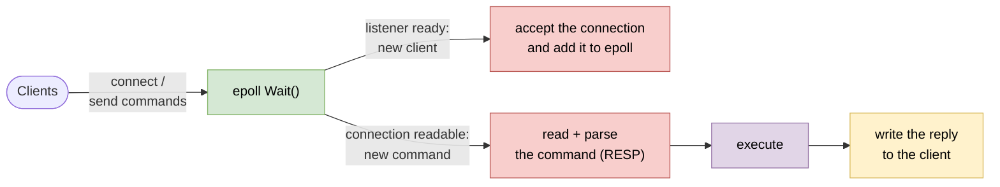
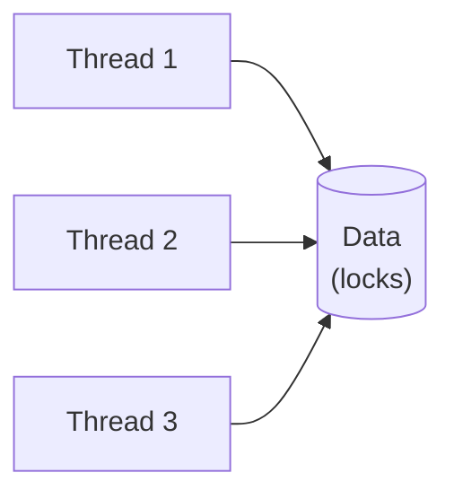
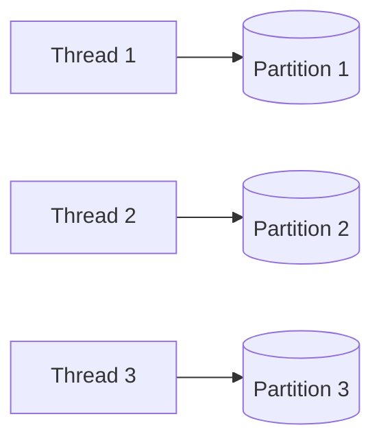
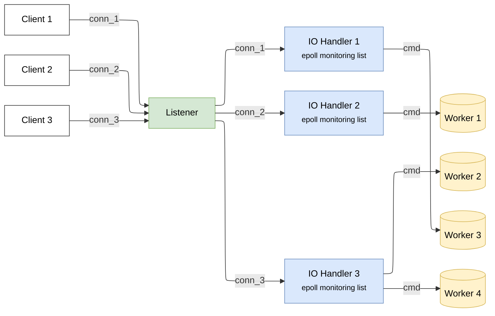

#  Single-thread and Multithreaded Redis-compatible server

A Redis-compatible server built from scratch in Go, with **two versions** you choose at startup:

- **Single-thread:** one `epoll` event loop handles every connection and command. This is the same model real Redis uses.
- **Multithread:** I/O threads handle client connections and pass commands to worker threads, each owning its own slice of the data (shared-nothing), so the work spreads across CPU cores.

Both speak RESP, the Redis protocol, so standard Redis tools such as `redis-cli`, `redis-benchmark` and `memtier_benchmark` work against them unchanged.

Since a server like this spends most of its time on I/O rather than computation, I built both to find out when adding threads actually helps. See the results in [Benchmark](#e-benchmark).

## A. What I built

| Area | Implemented |
|---|---|
| Basic commands | `PING`, `SET` (with `EX`), `GET`, `DEL`, `EXISTS`, `TTL`, `PTTL`, `EXPIRE` |
| Simple set | `SADD`, `SREM`, `SISMEMBER`, `SMEMBERS` |
| Sorted set (using B+ tree) | `ZADD`, `ZREM`, `ZSCORE`, `ZRANK` |
| Count-min Sketch | `CMS.INITBYDIM`, `CMS.INITBYPROB`, `CMS.INCRBY`, `CMS.QUERY`, `CMS.INFO` |
| Bloom filter | `BF.RESERVE`, `BF.ADD`, `BF.MADD`, `BF.EXISTS`, `BF.MEXISTS`, `BF.INFO` |
| Key expiry | Lazy + active deletion |
| Cache eviction | Random, LRU (all keys), approximated LRU |
| Graceful shutdown | Handle SIGINT / SIGTERM |
| Server engines | Single-thread, Multithread |

## B. Architecture

### 1. Single-thread

One thread runs a single loop. `epoll` watches the listener and every client connection, and `Wait()` blocks until one of them is ready:

- **Listener ready:** a new client is connecting. Accept it and add it to `epoll`'s watch list.
- **Connection readable:** a command has arrived. Read and parse it, execute it, write the reply, then go back to `Wait()`.

`Wait()` also has a timeout, so the loop wakes up regularly to delete expired keys even when no client is active.



### 2. Multithreaded

One loop can only use one CPU core. To serve many clients in parallel, I run several copies of the I/O loop on separate threads. The open question is **what to do with the data?** There are two models:

#### a. Shared-memory



All threads read and write the same data, so every access needs a lock. Threads can still read and parse in parallel, but data access happens one thread at a time, so adding threads mostly adds waiting.

#### b. Shared-nothing



Each thread owns one partition of the data and never touches the others, so no locks are needed. The price is complexity: every command must be routed to the thread that owns its key, and multi-key commands need extra work.

**This project uses shared-nothing**, trading extra complexity for real parallelism.

#### The multithreaded architecture



- **Listener:** accepts new connections and assigns each to an IO handler, round robin.
- **IO handlers:** each runs its own `epoll` loop, parses commands, routes each to the worker that owns its key (`hash(key) % numWorkers`), and writes replies back to clients.
- **Workers:** each owns one partition (keyspace, expiry and eviction state), executes commands one at a time, and deletes its own expired keys. No locks needed.
- **Channels:** IO handlers and workers communicate only through Go channels. A task carries the command and the IO handler's reply channel.
- **Special cases:** multi-key `DEL` / `EXISTS` are split per worker and the counts summed. Keyless commands like `PING` go to any worker.

More details are in [Documentation/9-Multithread_Redis](Documentation/9-Multithread_Redis/README.md).

## C. Project layout

```
Multithreaded_Redis/
├── main.go                   # entry point: asks for single-thread or multithread, then starts it
├── internal/
│   ├── resp/                 # RESP parser and encoder
│   ├── command/              # command handlers: strings, keys, set, sorted set, CMS, Bloom filter
│   ├── core/                 # Store: keyspace, expiry, eviction (one per engine / per worker)
│   ├── datastructure/        # simple set, B+ tree sorted set, CMS, Bloom filter, LRU list, eviction pool
│   ├── config/               # every tunable number in one place
│   └── server/               # shared plumbing: listener, per-connection read -> parse -> reply
│       ├── single_thread/    # the event-loop engine
│       └── multithread/      # listener + IO handlers + workers
├── io_multiplexing/          # i/o multiplexing wrapper
├── benchmark/                # run.sh (+ memtier_stats.py) and its latest result.md
├── Documentation/            # my notes for every part, 1 to 9
├── go.mod
└── README.md
```

## D. Getting started

I only implemented the I/O multiplexer with `epoll`, so the server currently runs on **Linux**. 

```bash
go run .
# Choose the server version:
#   1) Single-thread
#   2) Multi-thread
```

Then, from another terminal:

```bash
redis-cli -p 4000
127.0.0.1:4000> SET hello world EX 60
OK
127.0.0.1:4000> GET hello
"world"
```

## E. Benchmark

### 1. Server performance: single-thread vs multithread

`memtier_benchmark` on a laptop: Intel i5-1135G7 (4 cores / 8 threads), WSL2. Workloads 1 and 2 are a read-heavy cache mix, **80% GET / 20% SET** on 100,000 prefilled keys. The comparison is single-thread vs multithread. Each number is the median of 3 runs, with one server running at a time.

+) **Throughput (ops/sec, higher is better)**

| Scenario | Single-thread | Multithread |
|---|---:|---:|
| 1. Light workload (50 clients) | 95k | 45k |
| 2. High concurrency (200 clients, 4 client threads) | 92k | 172k |
| 3. Heavy command (SMEMBERS on ~400-member sets, 200 clients, 4 client threads) | 8.0k | 12k |

+) **Latency (mean / p50 / p99 in ms, lower is better)**

| Scenario | Single-thread | Multithread |
|---|---:|---:|
| 1. Light workload (50 clients) | 0.578 / 0.455 / 2.623 | 1.112 / 1.023 / 2.863 |
| 2. High concurrency (200 clients, 4 client threads) | 2.280 / 1.895 / 5.919 | 1.161 / 0.951 / 4.575 |
| 3. Heavy command (SMEMBERS on ~400-member sets, 200 clients, 4 client threads) | 25.948 / 24.831 / 40.703 | 17.847 / 17.279 / 35.583 |

- **Single-thread wins under light load (50 clients).** Each command is handled start to finish on one thread, while multithread pays for two hand-offs between threads per command. So single-thread has ~2x the throughput and about half the mean and p50 latency; p99 is about the same.
- **Multithread wins with many concurrent clients.** Reading, parsing and executing are spread across CPU cores, so at 200 clients it has ~1.9x the throughput of single-thread, about half the mean and p50 latency, and a lower p99.
- **Heavy commands also favor multithread.** Multithread gets ~1.5x the throughput of single-thread, with lower latency at mean, p50 and p99.
- Read more in [benchmark/result.md](benchmark/result.md).

### 2. Cache eviction: random vs LRU vs approximated LRU

Zipfian workload (alpha = 0.99): 5M requests over 1M keys, where a few hot keys get most of the requests.

+) **Hit ratio (higher is better)**

| Cache size (% of keys) | Random | LRU | Approx LRU |
|---|---:|---:|---:|
| 1% | 51.00% | 56.65% | 56.45% |
| 5% | 65.29% | 70.38% | 70.18% |
| 10% | 71.97% | 76.66% | 76.46% |
| 20% | 79.23% | 83.27% | 83.07% |

+) **Memory per key (lower is better)**

| Policy | Heap per key (bytes) | vs Approx LRU |
|---|---:|---:|
| Random | 87.8 | same |
| LRU | 175.5 | +87.6 bytes (2.00x) |
| Approx LRU | 87.9 | same |

- Approx LRU stays within 0.2 percentage points of exact LRU's hit ratio while using half the memory per key.

- Read more in [benchmark/eviction_result.md](benchmark/eviction_result.md).

## F. The journey

Each part's code is on its own branch, and its notes are in [Documentation/](Documentation).

| Part | Topic | Covers | Branch | Notes |
|---|---|---|---|---|
| 1 | Redis introduction | Processes, threads, goroutines; server models | [branch](https://github.com/TimSing6584/Multithread-Redis/tree/Part1-Redis_Introduction) | [notes](Documentation/1-Redis_Introduction/README.md) |
| 2 | TCP server | TCP server, thread pool, file descriptors, I/O models | [branch](https://github.com/TimSing6584/Multithread-Redis/tree/Part2-TCP_Server) | [notes](Documentation/2-TCP_Server/README.md) |
| 3 | I/O multiplexing + RESP | `epoll` event loop, RESP parser | [branch](https://github.com/TimSing6584/Multithread-Redis/tree/Part3-IO_Multiplexing_RESP) | [notes](Documentation/3-IO_Multiplexing_RESP/README.md) |
| 4 | Basic commands | `PING`, `SET`, `GET`, `TTL`, `EXPIRE`, `DEL`, `EXISTS`; key expiry | [branch](https://github.com/TimSing6584/Multithread-Redis/tree/Part4-Basic_Commands) | [notes](Documentation/4-Basic_Commands/README.md) |
| 5 | Set and sorted set | Simple set; sorted set on a B+ tree | [branch](https://github.com/TimSing6584/Multithread-Redis/tree/Part5-Set_SortedSet) | [notes](Documentation/5-Set_SortedSet/README.md) |
| 6 | Count-min Sketch and Bloom filter | Probabilistic data structures and their commands | [branch](https://github.com/TimSing6584/Multithread-Redis/tree/Part6-CMS_BloomFilter) | [notes](Documentation/6-CMS_BloomFilter/README.md) |
| 7 | Cache eviction | Random, LRU, approximated LRU | [branch](https://github.com/TimSing6584/Multithread-Redis/tree/Part7-Cache_Eviction) | [notes](Documentation/7-Cache_Eviction/README.md) |
| 8 | Graceful shutdown | Signals; shutting down cleanly | [branch](https://github.com/TimSing6584/Multithread-Redis/tree/Part8-Graceful_Shutdown) | [notes](Documentation/8-Graceful_Shutdown/README.md) |
| 9 | Multithread Redis | Shared-nothing architecture; benchmarks | [branch](https://github.com/TimSing6584/Multithread-Redis/tree/Part9-Multithread_Redis) | [notes](Documentation/9-Multithread_Redis/README.md) |

## G. What's next

- Persistence with RDB snapshots: right now all data lives in memory and is lost when the server stops. Periodically saving a snapshot to disk, and loading it on startup, would fix that.
- Faster pipelining: write all the replies from one read in a single `write` (and set `TCP_NODELAY`), instead of one `write` per reply.
- Authentication: right now anyone can connect and do anything. Add a password and check it before executing commands.

    ...